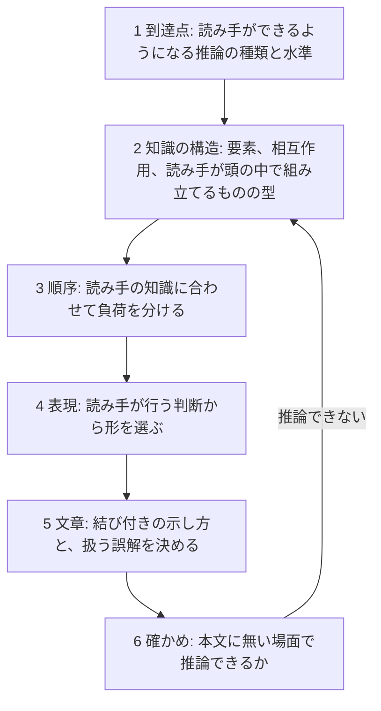

# 良い説明とは？

## 理解はどう起きるか（AI 生成回答ママ）

読み手は、新しい情報を自分がすでに知っていることに結びつけて、理解を自分で組み立てます。そして一度に頭に保持できる量はごく少ないものです。良い構成と提示の仕方は、この 2 つの性質から導けます。3 つの手本がしていることも、同じ性質で説明できます。

### 1. 一度に保持できる量は少ない

Sweller (1988, _Cognitive Science_ 12(2)) の認知負荷理論によれば、新しい要素を一度に多く抱えると、理解の枠組みを作るための作業記憶が使い果たされます。Mayer の multimedia learning の原則は、これを提示の規則にしたものです。

- pre-training: 用語と部品を本題の前に教える
- coherence: 本筋に要らないものを流れから除く
- signaling: どこが要点かを見出しや強調で示す

江添の序は、自分の書き方を「知識のブートストラップ」と呼んでいます。すでに学んだことだけを使って次を説明し、「まだ学んでいない概念が突如として無説明のまま使われて混乱すること」をなくす書き方です。説明されていない語が出てくると、読み手はそれを分からないまま抱えて読み進めることになります。

### 2. 新しい知識は、すでに知っていることに結びついて意味を持つ

- Ausubel (1968) は、学習に最も影響する単一の要因は、学習者がすでに知っていることだと書いています。
- National Research Council の _How People Learn_ (2000) によれば、事実は概念の枠組みの中で整理されていて初めて、思い出せ、別の場面に使えます。
- Chi, Feltovich & Glaser (1981) は、物理の問題の分け方を調べました。熟達者は根底にある原理で問題を分け、初学者は表面の特徴で分けました。

部品ごとの章立ては、表面の特徴による整理です。Mediator を設計する人に必要なのは、「完了をどう知るか」のような原理で引ける整理です。背景技術を先に置くのは、読み手がすでに持っている一般論に CV-2100 固有の事実を結びつけるためです。結びつく先が無い事実は、丸暗記するしかありません。

Kalyuga ら (2003, _Educational Psychologist_ 38(1)) の expertise reversal effect によれば、初学者を助ける提示は熟達者には邪魔になり、その逆も起きます。結論を見出しにする書き方は、枠組みを持つ読み手には速く読めます。しかし枠組みの無い読み手にとっては、結びつける先の無い命題になります。

### 3. 的確な理由を添えると、覚えられ、使える

Stein & Bransford (1979) は、「背の高い男がクラッカーを買った」という文に「棚の上の段にあった」という句を添えました。背の高さが関係する理由を説明する句です。すると再生率は約 42% から約 74% に上がりました。関係の薄い句を添えた場合は、助けになりませんでした。

理由があると、事実どうしが互いを説明し合い、ある事実を別の事実から導けるようになります。設計で新しい問いに出会ったときに答えが見えるのは、こういう状態にあるときです。ただし効くのは的確な理由だけで、もっともらしいだけの理由は効きません。

やる夫の前置きは、書き方の方針として次の 2 つを挙げています。

- 「新しい概念や定義を導入する際，なぜそれが必要なのかを可能な限り説明する」
- 数式を展開する場合は「その式変形の意図をできるだけ説明する」

### 4. 素朴な理解は、正しい説明を足すだけでは置き換わらない

_How People Learn_ によれば、学習者が持ち込んだ素朴な理解に働きかけないと、教えた内容は試験のためだけに覚えられ、外では元の理解に戻ってしまいます。Posner ら (1982, _Science Education_ 66) は、考えが置き換わる条件を 4 つ挙げています。

- 今の考えに不満があること
- 新しい考えが分かること
- 新しい考えがもっともらしいこと
- 新しい考えに実りがあること

やる夫の 6 章では、やる夫の「これで計算できるようになったお」に、やらない夫が「机の上ではな」と返します。これは 1 つ目の条件、今の考えへの不満を作る場面です。江添の配列の章も、まず素朴な `array_int_3` を書かせ、その限界からテンプレートへ進みます。

### 5. 違いを見ないと、その性質を見分けられない

Marton の variation theory (_Necessary Conditions of Learning_, 2015) によれば、ある性質に気づくには、他の条件を固定したまま、その性質だけが変わる例を見る必要があります。CV-2100 だけを見ていると、その性質はすべて機械一般の性質に見え、どこが機種によるのかを見分けられません。他の機種に一言触れるのは、詳しく説明するためではありません。見分けるための違いを一つ見せるためです。

### 6. 答えを読むと、分かった気になる

Rozenblit & Keil (2002, _Cognitive Science_ 26(5)) の illusion of explanatory depth によれば、人は身近な仕組みを自分が説明できる程度を大きく見積もります。実際に説明させると、その見積もりは崩れます。答えを先に置くと、読んだ時点で分かった気になり、「なぜ」を求める動機が消えます。網羅の検査と出典の検査では、この錯覚を見つけられません。

EMAN は「あいさつ」で、「何を知らないかを明らかにする」ことを目的に掲げています。やる夫は前置きに「各章のねらい」を置き、どの章が標準的でどの章が独自かを書いています。11 章については「ここまで読めばOK」と、読み終えてよい地点まで示しています。どちらも、読み手が自分の理解の状態を見張れるようにする仕組みです。

上の文献は、書誌と要旨の水準で確かめたものです。原典の本文は読んでいません。教材の本文に引用する場合は、原典を確かめてください。

## 理論から導いた説明の作り方（2026-10-28 追記）

上の節の見立てを、認知心理学、教育心理学、可視化、文章理解の原典で確かめ直しました。この節は、その結果から導いた説明の作り方を、AI が `mechanism-textbook` スキルを作る作業の中でまとめたものです。スキルの手順は、この作り方をもとにしています。

原典は `~/research/explanation-design/sources/` にあります。Larkin & Simon (1987) と Lemarié ら (2012) は、それより前の調査（`~/research/japanese-explanation-skills/`）で読んだものです。各主張には、確かめた水準を括弧で付けました。

- 本文: 原典の本文で確かめた
- 要旨: 要旨だけで確かめた
- 二次: 原典を引用した別の資料で確かめた

### 二つの入力: 到達点と、読み手の知識

原典を通して最も一貫していたのは、効く順序と表現が読み手の既有知識によって変わり、効いたかどうかの結論が何を測るかによって変わる、という結果です。

- 文と文の関係を明示した文章は、知識の少ない読み手を助けました。知識の多い読み手では、関係を省いた文章のほうが良い結果になりました。さらに、表面の記憶で測るか推論の課題で測るかで結論が変わりました（McNamara ら 1996、要旨）。
- 負荷の重さを決める要素の相互作用の多さは、材料だけでは決まらず、読み手の知識との組み合わせで決まります（Sweller ら 2019、本文）。
- 先に手順や概念を教えると、問題の深い構造の学習が損なわれることがありました。対照的な事例から先に考えさせた群は、構造の学習と転移で上回り、公式の計算では差がありませんでした（Schwartz ら 2011、本文）。

ここから、説明を組み立てる前に二つを決める必要があります。一つは到達点で、読み手が最終的にできるようになる推論の種類と水準です。用語を思い出せること、仕組みを説明できること、本文に無い場面で結果と理由を導けることは別の水準であり、どれを目指すかで順序も確かめ方も変わります。もう一つは読み手の知識で、本人の発言や記録から得ます。推測では埋めません。

### 作り方の段

#### 1. 到達点を決める

到達点は、答えを並べた一覧ではなく、推論の種類と水準で書きます。答えの一覧で決めると、読み手は答えを憶えるだけで終わり、確かめも記憶の水準にとどまります。

#### 2. 知識の構造を見積もる

作業記憶に同時に保持できるのは 3〜5 個、平均で 4 個前後のまとまりです。まとまりの大きさは既有知識で変わります（Cowan 2001、本文）。負荷の重さは要素の数ではなく、同時に関係づけなければならない要素の多さで決まり、その多さも読み手の知識との関係で決まります（Sweller ら 2019、本文）。

あわせて、読み手が頭の中で組み立てるものの型を見分けます。何がどこにあり何とつながるか（構造）、時間とともに状態がどう変わるか（振る舞い）、形・位置・向き・距離（空間と形）、定義から結果を導く式（式と導出）、データから主張までの推論（主張と根拠のつながり）などです。過程にも、原因から直接決まるものと、多数の要素の相互作用から全体として現れるものがあり、後者を前者として理解すると誤りが残ります（Chi 2005、要旨）。型によって、順序と表現の選び方が変わります。

#### 3. 順序で負荷を分ける

順序についての知見は、どれも条件付きでした。

- 要素を一つずつ教えてから相互作用を教える順序は、既有知識の少ない読み手にだけ効きました。知識の多い読み手には効かないか、全体から入るほうが有利でした（Sweller ら 2019 の整理、本文。Ayres 2006、要旨）。
- 見出しや予告で全体の構造を先に示す方法は、構造が複雑な文章でだけ効きました（Lorch & Lorch 1996、二次）。
- 知識が要る場面を先に見せてから教える方法は、概念の理解と転移で効き、手続きの習得では差がありませんでした。年少の学習者と、領域を問わない技能では、先に教えるほうが有利でした（Sinha & Kapur 2021、要旨）。一方、ほとんど指導しない方法は、指導する方法より効果も効率も低いとする総説もあります（Kirschner ら 2006、本文）。

したがって、順序は読み手の知識と到達点から選ぶもので、どの場合にも使える一つの順序はありません。上の節で触れた先行オーガナイザ（全体の見取り図を先に置く）も、この条件付きの選択肢の一つです。

本文に置くか参照資料に置くかは、Diátaxis の区別で判定できます。作業の最中に引くものは参照資料に、作業から離れて理解するために読むものは本文に置きます。ただし Diátaxis は実証研究に基づく枠組みではなく、技能を二つの軸で分けた概念上の整理です。本筋に要らない情報が理解を下げることは、次の 4 に挙げる研究が示しています。

#### 4. 表現は読み手の判断から選ぶ

同じ情報でも、図にすると探索と再認が楽になり、文章では同じ推論に手間がかかります（Larkin & Simon 1987、本文）。表現の形は、読み手がその箇所で行う判断や推論から選びます。

最初に決めるのは、図を描く空間です。外に描く図の構造は、読み手の頭の中に作らせたいものの構造に合わせます（Tversky ら 2002 の一致の原則、本文）。仕組みの振る舞いを思い描かせるなら、仕組みが実際に動く空間に描きます。式の関係を思い描かせるなら、変数を軸にしたグラフに描きます。試行では、レイトレーシングの全反射を、屈折率と境目の入射角を軸にしたグラフで説明する図が作られました。筆者は、理論の説明としてはあり得るが、レンダリングで光線がどう飛ぶかを思い描くには合わないと判定しました。

形ごとに、原典から次のことが言えます。

- 量を正確に比べさせるなら、共通の軸の上の位置で表します。ただし Cleveland & McGill (1984) の知覚の課題の順位（位置、長さ、角度、面積、体積、濃淡の順）は、論文の中で仮説として示されたものです。実験で比べたのは位置と長さ、位置と角度だけでした（本文）。順位はおおむね追試されましたが、角度と長さの関係は予測と合いませんでした（Heer & Bostock 2010、本文）。比べる判断か割合の判断かで、正確に読める形の順位も変わります（Simkin & Hastie 1987、本文）。
- アニメーションの平均の効果は小さく（g = 0.226、Berney & Bétrancourt 2016、本文）、一度流れると見直せないことが負担になります。段階を見比べさせるなら、静止図を並べます（Tversky ら 2002、本文）。
- 3 次元の図では、自分で回せるかどうかより、課題に要る面が見えていたかどうかが成績を分けました（Keehner ら 2008、本文）。3 次元の模型は空間能力の高い学習者にだけ効き、低い学習者では得点が下がったという報告もあります（Huk 2006、要旨）。透視図では距離や角度が系統的に歪み、見る人はそれに気づきにくいので（Cutting 1997、本文）、測らせる量は断面図に示します。
- 図と式は役割が違い、図は形と位置を、式は厳密さと一般性を担います。学習者は表現の間を行き来するのが苦手だという報告が多くあります（Ainsworth 2006、本文）。そのため、式の記号が図のどこに当たるかは、書き手が図の中か図のすぐ隣に示します。図と説明が離れていると、読み手は両方を頭に保持しながら行き来することになります（Ayres & Sweller 2005、本文）。
- 二つのものの違いは、対応する部分をそろえて並べると目立ちます（Gentner & Markman 1997、本文）。
- 写実的な絵や知覚的に豊かな具体物は、かえって正答を減らすことがありました（McNeil ら 2009、本文）。本筋に要らない図や逸話は理解を下げ、作業記憶の少ない読み手ほど影響を受けます（Sanchez & Wiley 2006、本文。Harp & Mayer 1998、要旨）。

#### 5. 文章の結び付きと、扱う誤解を決める

- 文と文の関係をどこまで明示するかは、読み手の知識に合わせます（McNamara ら 1996、要旨。Kalyuga ら 2003 の熟達者逆転効果、要旨）。
- 見出しや予告などの信号は、信号した内容を思い出しやすくします。一方で、信号していない内容は思い出しにくくなることがあります（Lorch & Lorch 1996、二次）。箇条書きは項目を思い出しやすくする一方、周りの文を思い出しにくくしました（Jansen 2014、要旨）。理由や条件は、箇条書きに切らずに文で書きます。
- 見出しの働きが違えば効果も違うという整理はありますが（Lemarié ら 2012、本文）、見出しを結論の命題にする書き方を直接比べた研究は見つかりませんでした。見出しを話題か問いにする方針は、筆者の観察と試作の記録に基づいています。
- 的確な理由を添えると、再生が上がりました（Stein & Bransford 1979、数値は二次）。ただし、この実験が測ったのは手がかりからの再生で、理解や転移ではありません。
- 書き手が持ち込んだ類推は、成り立たなくなる所を示します。一つの類推が、深く保持された誤った知識を生むことがあります（Spiro ら 1989、要旨）。

誤解は、読み手がそれを持っていると観測された場合にだけ扱います。誤解を否定する文章で読み方が変わったのは、その誤解を持っていた読み手だけでした（Kendeou & van den Broek 2007、本文）。誤概念の研究は、筆記の試験と面接（Clement 1982、要旨）、二段階の診断問題（Treagust 1988、要旨）、授業前の調査（Kowalski & Taylor 2009、本文）のように、誤概念を観測で特定してから扱っています。

読み手が持っていない誤解を持ち出して否定することの害を、直接測った研究は見つかりませんでした。害があるという判断は、読み手は書かれたことには理由があると考えて読む、という関連性理論からの推論です（原典未読）。否定するとかえって誤解が強まるという効果は、頑健な現象ではないと結論されています（Swire-Thompson ら 2020、本文）。

#### 6. 本文に無い場面で推論できるかで確かめる

人は、自分が仕組みを説明できる程度を過大に見積もり、実際に説明を試みるとその見積もりが下がります（Rozenblit & Keil 2002、本文）。この錯覚が崩れたのは仕組みを説明させたときで、理由を並べさせても崩れませんでした（Fernbach ら 2013、要旨）。そのため、本文に無い場面について、結果と理由を導かせて確かめます。何で測るかで結論が変わるので（McNamara ら 1996、Dochy ら 1999、どちらも要旨）、確かめる問いは 1 で決めた水準に合わせます。

### 理論では決まらないこと

- 原典の多くは、どの形がどの条件で効くかという制約を与えますが、一つの形には決めません。3 次元の仕組みの見せ方のように答えが複数ある選択は、到達点と読み手に照らした判断と、人による確認で決めます。一つの題材の試行で出た指摘から「この内容にはこの形」という規則を作ると、その題材に合わせた規則になります。2026-10-28 に、`mechanism-textbook` からそうした規則を外しました。
- 模型を先に作り、図をその出力から作ることと、ページを実際のブラウザで開いて確かめることは、理論ではなく実務の規則です。前者は、explorable スキルの盲検の試験で、4 件中 2 件の数値や図が規格と食い違ったことから来ています。
- データ分析の筋道の示し方を、読み手の理解で効果を測った研究は見つかりませんでした。同じデータでも分析者によって結論が大きく散ることは示されています（Silberzahn ら 2018、本文）。書き方は、ほかの段の原則から導くしかありません。
- AI が書いた説明で人間の理解が上がったかを測った記録は、調べたスキルにも研究にもありませんでした。確認役のエージェントが正答できても、人間の読み手が理解できる証拠にはなりません。

### 上の節の文献について確かめたこと

上の節は AI の回答をそのまま残したもので、その本文は変えていません。後から確かめた結果は次のとおりです。

| 文献 | 確かめた結果 |
|---|---|
| Stein & Bransford (1979) | 原典は有料で未読。42% と 74% は Schwartz, Tsang & Blair (2016) の教科書で確かめた。測ったのは手がかりからの再生 |
| Rozenblit & Keil (2002) | 本文で確かめた |
| Sweller (1988) | 要旨のみ。相互作用性が既有知識で変わることは Sweller ら (2019) の本文で確かめた |
| Kalyuga ら (2003) | 要旨のみ |
| Chi, Feltovich & Glaser (1981) | 要旨の冒頭のみ |
| Posner ら (1982) | 書誌のみ |
| Ausubel (1968) | 未取得。先行オーガナイザが効く条件は 3 を参照 |
| National Research Council (2000)、Marton (2015) | 未取得 |
| Mayer の multimedia learning の原則 | 効果量は Mayer 自身の集計。独立の総説では確かめていない |
